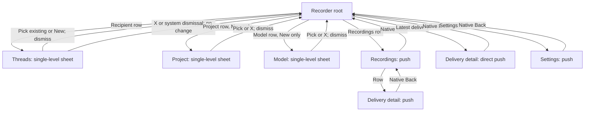
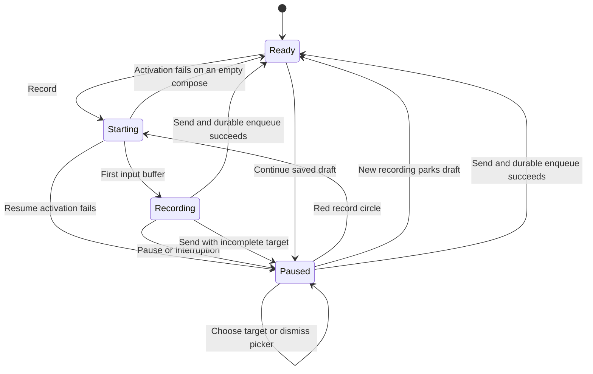

# BB Watch — voice delivery design

**Latest direction:** [voice-notes update](specs/bb-watch-voice-notes-direction.md)
adopts merged root history, reduced statuses, the red control above its recipient
and plugin-assisted Auto routing / explicit Reply. [Visual references](docs/design/voice-notes-references.md).
The 2.0 baseline below and its sprite require reconciliation with that update
before implementation; do not treat old top-recipient or mandatory-target flows
as the latest design.

Version 2.0 · visual clarification 18 October 2026. Design for a fresh build,
not the installed application. [Product contract](specs/bb-watch-product-spec.md).
[Architecture and gated plan](specs/bb-watch-architecture.md).
[Fable review](specs/reviews/bb-watch-v2-fable-review.md).
The behavioral baseline is the reviewed 2.0 contract. The state inventory and
concept sheet below elaborate it; the concept sheet is not a native screenshot
or an additional platform validation.

## 1. Design principle

The watch answers: am I recording, where will it go, and has BB safely received
it? The computer owns transcription, conversation and agent execution.

One full-screen native recorder is the root. Respect real watchOS safe areas,
time/system chrome, Crown scrolling, lists and toolbar controls. No inner phone
frame, custom floating navigation bar or rounded card containing the whole app.
Use system fonts/SF Symbols, black/white, sparse lime accent and red capture.
The default recorder viewport contains the recipient, capture control and Send
when applicable. Optional New fields/history follow the primary controls, rather
than pushing them below the fold. Validate 49 mm and 45 mm default-text layouts;
large accessibility text scrolls naturally instead of shrinking to fit.

The waveform is a supporting real level meter, not decorative motion. A compact
five-bar meter may be used while genuine input is arriving; a static microphone
is an acceptable quieter alternative. A small elapsed `m:ss` is secondary,
never the hero. Active, paused and idle keep control anchors stable.

## 2. One navigation model



Only one sheet can be active. **A sheet never contains another sheet or navigation
hierarchy.** Its visible system Close symbol (X) dismisses the picker without a
choice. Picking a row commits exactly one value and dismisses. Back is absent
from pickers; it pops the actual invoking path on pushed history/detail/settings.
Do not replace Close with a microphone or relabel it as a navigation shortcut.
Add an explicit dismiss control rather than assuming SwiftUI supplies it.

The visible recipient row opens Threads. No custom swipe-to-chooser shortcut:
native back/dismiss/Crown interactions retain their usual roles. Dismissal does
not start/resume capture, send, delete or change a value. Focus and scroll return
to the invoking recorder; incoming network events never navigate the interface.

## 3. Target selection and New

Threads is a small recent list (initially 30 visible, recently updated threads),
with project subtitle only when needed and a `New thread` row. Exact child IDs
are retained. A stale/offline cache is labeled with its source age when materially
stale; it is not silently replaced with a different target. The plugin validates
permission and availability. No model chips, agent counters or chat preview UI.

Choosing New commits a local New context and returns to the recorder. The last
valid project and `Project default` reduce setup; neither requires a server
mutation. Optional Project and Model rows live below primary controls, only in
New. Each opens a focused one-value picker with X. No wizard, `Use target`,
required title, extra Create button or staged multi-page transaction.

Model choices use the real project's catalog; a project default is genuine nil
intent, never a hidden global override. An unavailable catalog does not block
recording or selecting a known project default. A rejected override stays visible
as invalid until explicitly repaired; no silent fallback to a different model.

After the context's first Send, its project/model are frozen. Keep those rows
visible as read-only values without chevrons; they do not open pickers. A short
caption, `Choose New thread to change project or model`, explains the restriction.
Later recordings in that pending context follow the same future thread. A different project/model
requires explicitly choosing New again. A receipt resolving that context cannot
change the target of an unrelated current compose draft.

Send with no target pauses capture and opens Threads. New without a valid project
opens Project instead. A choice returns to the paused recorder; another explicit
Send is required. No selection itself sends or creates anything remotely.

## 4. Capture, draft restoration and search

One live microphone and one active compose ID. Pause finalizes the current part;
resume continues that same draft. Successful durable enqueue ends it and returns
root ready for a new recording. The red circle means record/resume; red pause
bars mean pause. A separate up arrow means explicit Send. No play-plus-record
hybrid, manual Save or discard X beside the recording control.

A pending audio activation is represented until the actual input callback.
There is no success haptic or animated input before capture really starts.
Permission denial/unavailable input has a truthful recovery caption. No assumed
millisecond activation guarantee. A system interruption or cold-start recovery
returns a paused draft with `Paused · interrupted` and a known cause when available;
resuming always requires the real control. A normal pause is not an interruption.

The active paused draft restores by ID after returning. Other unsent drafts can
remain autosaved in history. A secondary **New recording** action parks the
paused draft and opens a new empty compose state without starting the microphone.
History **Continue** explicitly restores a selected unsent draft, parking the
currently paused one. Neither sends/deletes. Do not require Send or Delete just
to save a second thought while unpaired. No silent "newest draft wins" switching.

A target picker may remain open during live capture with a small recording
indicator. **Voice search cannot steal the recorder microphone.** During capture,
use cached recent choices; entering dictation/search requires an explicit
`Pause to search` action that first finalizes/pauses capture. Dismissal does not
resume. The same rule applies to any search field or local replay. Replay is
unavailable during capture; Record stops existing playback before starting input.

Actual wrist-down/not-frontmost capture capability is a hardware gate; legitimate
recording background execution must not be confused with background networking.
If the OS interrupts capture, retain finalized parts and explain the pause.
Cold start does not pretend to know whether the user force-quit or the OS killed
it; reconcile durable state and require an explicit resume.

## 5. Screens and their exits

| Surface | Main content/actions | Exit semantics |
|---|---|---|
| Root idle | target; prominent record circle; latest-delivery/Recordings; Settings below | No fake Back at root; app exit preserves drafts |
| Root activation pending | honest pending input; no live waveform | Activation failure returns a recoverable state; no fake success |
| Root recording | target; real input; secondary elapsed; pause; separate Send | Picker selection/dismissal does not stop/resume capture; explicit search pause is distinct |
| Root paused | target; subdued meter; record circle to resume; Send | Secondary New recording parks this draft; no delete disguised as Close |
| Root paused after interruption | same paused composition; `Paused · interrupted` caption | Resume/Send are explicit; saved parts are retained |
| Root New | same recorder; optional Project/Model rows below primary controls | Focused pickers return here; no server creation from navigation |
| Threads/Project/Model | one-value native list; X; voice-search recording guard | Pick commits one choice; X/system dismissal commits nothing |
| Recordings list | newest requests; unsent drafts; recipient, age, truthful delivery glyph/caption | Native Back restores root; row pushes detail |
| Delivery detail | exact recipient; durable receipt/failure; local replay; only safe repair/delete actions | Native Back pops its real invoker (history or root) |
| Settings | connection/pairing identity, storage used, Forget pairing | Pushed page with native Back; any picker remains single-level |

```text
IDLE                      RECORDING                 PAUSED
[Recipient           >]   [Recipient           >]   [Recipient           >]
                              Recording                 Paused
        ●                       ▁▂▅▃▂                    ─▂▅▃─
      Record*                  0:24                      0:24
                               [Ⅱ]                      [●]
                           [↑ Send*]                 [↑ Send*]
[Latest / Recordings  >]   [Delivery / Recordings >]  [New recording          ]
                                                    [Latest / Recordings   >]
[New fields if needed ]   [New fields if needed ]   [New fields if needed   ]
```

Asterisks are accessibility labels, not mandatory visible words. A visible label
is allowed where an icon is insufficiently clear. Primary Record/Pause/Resume and
Send have at least the project's 44-point target (Apple's default watchOS control
size; see [HIG Accessibility](https://developer.apple.com/design/human-interface-guidelines/accessibility))
and a full hit region; no dead
center Spacers. Do not expand labels into half-screen status words. Actual default
screen screenshots, not these ASCII sketches, decide whether the composition fits.

## 6. Delivery presentation and safe actions

The main recorder remains available while the outbox works. A compact latest
receipt row uses `Saved`, `Queued`, `Sending`, `Received by BB` or `Needs attention`.
Acknowledged progress can be shown in detail; transport chunk counts are not
primary screen content. `Waiting for network/BB` needs an actual supporting
network/server result; an OS-deferred task without an explanation says `Queued`.
No invented percent, stage duration, ETA or timed progress animation.

Received means durable computer-side audio/job ownership, not completed ASR or
an agent result. Desktop ASR/submission facts are optional detail, never a new
watch progress modal. A failed ASR cannot revoke an upload receipt or show Send
again. Appropriate transfer Retry reuses the same recording ID and frozen audio.

Unsent drafts: explicit Delete in detail with confirmation. Enqueued/uncertain
intake: retain audio while querying receipt or confirming server abandon; zero
ACKs is not proof of zero acceptance. Retarget creates a replacement operation
only after a durable fence blocks the old one. Received local copies: explicit
`Delete local copy` says it does not retract anything on BB. No automatic local
cleanup in this release. Audio deletion never erases the plugin deduplication
fact needed to reject delayed duplicate commits.

Haptics occur on actual start/pause/resume and a newly confirmed foreground audio
receipt. No repeated receipt haptic on polling; a background receipt does not
promise a haptic or notification. No notifications in this release.

## 7. Motion, privacy and accessibility

Use short system-consistent content replacements (approximately 150–200ms),
keyed to actual revision. Keep controls stable and identical refreshes quiet.
No typewriter output, activity shimmer or whole-screen pulsing. Reduce Motion
removes nonessential custom movement; system transitions remain system-owned.

Always On stops the level animation and hides sensitive titles as needed; a static
capture glyph/caption remains truthful, with infrequent timer updates. Never hide
the fact that recording is live for the sake of privacy. Dynamic Type uses Crown
scrolling. VoiceOver names capture/pause/resume/send/close/back and the recipient;
focus is isolated to the sheet, and covered root controls are inaccessible.

## 8. Desktop plugin interface

A small plugin inbox is the operational surface, available within BB. It shows
original audio, exact thread/pending New context, durable receipt, processing
failure/transcript and verified core submission facts. It links to the actual
thread. Audio is stored by the plugin; no audio-native timeline API is invented
and no fake `audio received` prompt is sent just to draw a message.

Retry ASR reuses audio and completed groups. Ambiguous core dispatch requires
reconciliation; no blind Retry. Deletion/retention/revocation are explicit desktop
operations. Expert CLI/diagnostics may help implementation, but cannot replace
the promised inbox in the complete release. No transcript content is silently
modified to manufacture UI or reconciliation evidence.

## 9. Design validation

[Fable's review](specs/reviews/bb-watch-v2-fable-review.md) and the lead evaluate
all routes: target mid-capture, search/mic interaction, X without a choice, New
project/model, missing target Send, unsent draft parking, direct/detail Back,
replay during capture, interrupted capture, offline/unknown receipt and pairing.
Native simulator tours cover 49/45 mm default/large text, VoiceOver and Reduce
Motion; hardware tests separately prove capture and background audio delivery.
An installed binary alone is not navigation or reliability acceptance.

Primary guidance:
- [Apple HIG: Sheets](https://developer.apple.com/design/human-interface-guidelines/sheets)
- [Apple HIG: Modality](https://developer.apple.com/design/human-interface-guidelines/modality)
- [Apple HIG: Designing for watchOS](https://developer.apple.com/design/human-interface-guidelines/designing-for-watchos)
- [Apple: Making background requests](https://developer.apple.com/documentation/watchos-apps/making-background-requests)
- [Apple: WKURLSessionRefreshBackgroundTask](https://developer.apple.com/documentation/watchkit/wkurlsessionrefreshbackgroundtask)
- [Apple: Life cycles](https://developer.apple.com/documentation/watchkit/life-cycles)

This is a product-specific design, not Apple certification. The architecture's
platform/auth/ingress proofs remain release gates; UX cannot promise immediate
background execution or exactly-once core mutation unsupported by BB.

## 10. Visual state inventory

The [concept sprite](docs/design/voice-delivery-v2.png) illustrates the states
below. [Generation brief](docs/design/voice-delivery-v2-prompt.md). Rendered
controls and text are illustrative; this document and the product spec govern
behavior if a generated pixel differs. Thread/project names and model catalog
entries in the picture are examples, not queried BB data. No runtime claim is
made by the artwork.
The generated panels do not establish pixel measurements: control diameters,
anchors and viewport proportions still vary in the image. Implementation must
use the shared sizes/anchors in §1 and §10 and validate native 49/45 mm screens;
do not copy those illustrative spacing differences into the app.

### Primary recorder and delivery are independent

The recipient row is a compact target button: title, optional project subtitle,
chevron. It has no agent-activity glyph, Working caption or agent runtime. A
transfer receipt belongs to its own row below capture controls; it must not
describe a new draft's destination by accident. Its caption, glyph and age refer
to the same recording, and tapping it opens that recording's detail.

| Panel | Composition | Main interaction and next state |
|---|---|---|
| 01 Ready | Recipient, central red circle, history below | Record starts without a selected target or connection; input activation precedes Recording |
| 02 Recording | Same recipient and center anchor; quiet five-bar input; small elapsed; red pause; separate lime up arrow | Pause seals this part; Send freezes this draft only after local enqueue succeeds |
| 03 Paused | Same anchors; static input; red circle; up arrow; New recording; history | Circle resumes this draft; New recording parks it and returns Ready without starting input |
| 04 New | Ready recorder with Project and Model below primary controls | Each picker changes one local value; thread creation waits for computer-side dispatch |
| 05 Threads | Full-screen one-value list, X; New thread and recents | A row commits and dismisses; X commits nothing; recording indicator and Pause to search appear when needed |
| 06 Project | Full-screen one-value list, X | Pick returns to New; X leaves its existing value; no automatic Send |
| 07 Model | Full-screen catalog, Project default, X | Pick returns to New; unavailable catalog shows a retry affordance and retains known default intent |
| 08 Queued | Ready recorder plus a separate queued receipt below | Another recording is immediately available; receipt opens detail; dimming does not change the recipient or queue identity |
| 09 Received | Ready recorder plus a lime check and Received by BB receipt | Upload ownership is complete; no ASR waiting screen or agent Done state replaces the recorder |
| 10 Recordings | Pushed list: recipient, delivery/draft glyph and caption, secondary age | Row opens detail; Back returns to root; Continue is an explicit draft action |
| 11 Delivery detail | Pushed detail: exact recipient, receipt, recorded duration, playback, safe actions | Back returns to its actual invoker; received copy offers Delete local copy with non-retraction explanation |
| 12 BB plugin | Computer-side inbox with audio, processing facts and actual thread link | Retry ASR and ambiguous submission recovery happen here |

Recording, paused, New, queued and received are compositions of the same root,
not five pages or a paging carousel. The root retains its target after Send;
choosing a different target for the next draft never retargets that receipt.
While New is pending, follow-ups retain its context. A background mapping to the
real thread updates only that same context, never an unrelated draft.



The diagram describes compose state only. An enqueue failure keeps the stopped
recording paused and recoverable, with its audio and target; it does not clear
the active draft or draw a queued receipt. No transition begins from a timer.

### Receipt vocabulary and repair

| Actual fact | Visible delivery row | Detail action |
|---|---|---|
| Unsent local draft | Neutral draft glyph; Saved locally | Continue, replay or confirmed Delete; replay requires capture paused |
| Durable local enqueue, not currently transferring | Clock; Queued | Reconcile status; Cancel delivery only through confirmed server abandonment |
| Actual transfer progress observed | Upload glyph; Sending | Acknowledged progress if known; no fabricated percent or ETA |
| Network or BB reachability failure known | Clock; Waiting for network or Waiting for BB | Retain audio; automatic bounded recovery; explicit transfer Retry reuses the operation |
| Final response lost, receipt unknown | Neutral unresolved glyph; Checking receipt | Query the same recording; no Send again, safe-delete claim or Cancelled claim |
| Durable audio/job receipt obtained | Lime check; Received by BB | Replay or confirmed Delete local copy; ASR facts remain secondary |
| Transfer needs user action | Attention glyph; Needs attention | Explain pairing, unavailable recipient or storage cause; show only applicable repair |
| Server confirms abandoned operation | Neutral cancelled glyph; Cancelled | Delete or explicit Send to another thread as a replacement operation |

Received by BB stays a successful audio-delivery fact if later ASR fails.
No agent status is substituted for it. A local receipt refresh does not trigger
repeated haptics, reanimate unchanged text or move focus. Never label OS-deferred
tasks Sending solely because a task has been scheduled.

### States outside the sprite

| Case | Presentation and exit |
|---|---|
| Starting input | Quiet Starting… caption; no live bars or success haptic until real input; failure returns to prior recoverable mode |
| Interrupted capture | Paused composition, Paused · interrupted and known cause; red circle resumes explicitly |
| Low storage | Paused composition and Storage full, recording saved; previously checkpointed audio remains; no false full-duration claim |
| Unpaired/offline first launch | Recording remains available; no target data is invented; Settings explains Pair BB; drafts can be parked |
| Missing target on Send | Stop/pause, open Threads or missing Project; choose or X returns Paused; Send must be tapped again |
| Rejected frozen target | Needs attention with the cause; cancellation confirmation precedes replacement; no silent model/thread fallback |
| New context already sent once | Project/Model visible as read-only values with no chevrons; explanation in §3; choose New thread for another configuration |
| Account change/revocation | Existing outbox stays bound to its original BB identity; pairing repair does not reassign audio; new unsent capture remains possible |
| Empty history or picker | Short empty-state caption and the existing Back/X; no extra Get started wizard |

### Motion specification

Compose controls keep their centers between recording and paused. Pause bars
replace the red circle in place; the quiet meter freezes on Pause, rather than
continuing a fake waveform. Enqueue success returns that center to the idle
record control and inserts the receipt below it. Only a new receipt revision
crossfades its glyph/caption in approximately 150–200 ms, without text sliding
through adjacent controls or a typewriter effect. Reduce Motion uses an
immediate content replacement. Native push and sheet transitions remain native.

### Desktop inbox detail

The default inbox is a list, not a conversation: received time, target, local
audio playback and processing caption. Selecting an item reveals retained
audio, transcription groups/error, complete transcript when available, and
verified core acknowledgement. Captions distinguish Received, Transcribing,
Waiting for earlier recording, Submitted and Needs attention. Submitted means
BB core acknowledged input, not that an agent finished.

Retry ASR uses the same audio/job and completed groups. Acceptance unknown shows
the transcript, any known thread and Reconcile; Send again requires the
architecture's explicit duplicate-risk confirmation. Retention and Delete audio
explain what is removed without erasing receipt/order facts. Plugin settings name
the configured voice service and explain hosted processing when applicable.
No watch button pretends to open a thread on the distant computer.
