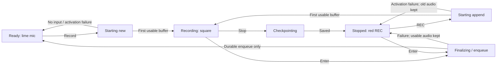

# BB Watch — voice terminal design 3.0

19 October 2026. **Consolidated current design. Not implemented or hardware validated.**

Read the [product contract](specs/bb-watch-product-spec.md) and
[transition/error contract](specs/bb-watch-transition-contract.md) together.
[Current concept](docs/design/voice-terminal-v8.png) ·
[generation brief](docs/design/voice-terminal-v8-prompt.md) ·
[delivery indicator annotation](docs/design/voice-terminal-v8-delivery.svg).
The concepts are illustrative, not native geometry, HIG conformance or runtime
evidence. Text and the annotated companion define current glyph semantics.

## Two surfaces

**Recorder:** input, one lower thread/context row. **Threads:** one Close-X sheet
for selection and inline current-thread peek. No recording list, playback,
transfer-detail screen, separate Reply/New/project/model route or settings theater.
Messages and detailed notifications remain in full BB. First setup, permissions,
discard and actionable error alerts use native exceptional presentations.

## Recorder anchors

| Mode | Input region | Center control | Right control |
|---|---|---|---|
| Empty | Lime microphone | Initial capture action | Absent |
| Recording | Real left-to-right amplitude waveform | Neutral square: Stop/save | Lime curved Enter: send |
| Stopped | Frozen/dim waveform | **Red button with white filled-circle REC glyph: append** | Same Enter: send |

For nonempty audio, X discard stays on the left, square/REC in the center, Enter
on the right. None swaps into another action's previous hit area. Keep all three
anchors, the waveform area and the thread row stable. Initial capture retains
its distinct lime microphone; the red REC only appends to retained audio. No Play,
Send label, elapsed timer, pause bars or halo. Color is reinforced by square /
filled circle / Enter shapes and VoiceOver labels.

Only a real input buffer moves the waveform and confirms capture. Pending start,
checkpoint, append start and enqueue have guarded input-owned indicators in the
same region; a progress treatment never implies agent activity or actual input.
Return to ready after durable enqueue, without waiting for network or ASR.
Detailed event/error controls are specified in the transition contract, including
an older failed operation while a different context records.

The diagram does not replace failure guards: partial/zero-usable-audio recovery,
outbox reconciliation and native exceptional prompts follow the transition
contract. Restoring a draft after launch/context change never starts the mic.

## One lower component, two different facts

For an exact thread, show actual thread title, activity glyph and disclosure. The
glyph represents BB idle/working/question/done/failure only; unknown/stale is
neutral. Upload/transcription/receipt/failure cannot replace this thread glyph.
A recorded thought's local/transport exception is input-owned and separately
accessible; it never fabricates thread Done or silently disappears. Its indicator
occupies the top-leading recorder toolbar slot opposite the system clock,
outside X/REC/Enter and the thread row, remains
visible during capture, and opens Threads with Issues expanded without stopping
the microphone. The slot uses a neutral dot for waiting and an outlined
exclamation-circle for attention, with one stable hit region. It is inert during
guarded transitions. No receipt within W-wait since enqueue shows waiting even
if the OS deferred all attempts; update at the next permitted UI refresh, never
a promised background wake. Absence of an indicator is never proof of delivery.
Unreadable local storage
blocks recording but retains an accessible Retry recovery control in the center
slot after alert dismissal. Retry does not guarantee repair of deterministic
whole-store corruption: the first release honestly stays blocked pending
developer-assisted recovery with audio and ledgers preserved, never an empty
replacement store. The native recovery alert explains this limitation.

For unbound routing show BB with a routing glyph, not Auto/New or a fake last
thread. Remain in that context until an explicit selection or authorized link.
No extra pinned chip, history row, receipt caption or model metadata underneath.
Long titles use native truncation/accessibility and remain readable in Threads.

Use the transition contract’s explicit glyph shapes: working is three bars,
Done a flag, and a checkmark means current selection only. The v8 raster’s ring
and Done check are superseded by this vocabulary and the annotated companion.
Input progress and thread activity never share a shape family.

## Threads and return behavior

Tap the one row → one sheet. Close X dismisses with no implicit selection,
capture, send or delete. Another row selects a context and dismisses only after
the old draft is safely stopped/checkpointed. The current row expands a short
original BB excerpt inline using a down/up expander; collapse/Close returns without another reader page.
BB routing is an explicit selectable context. A conditional Issues row exposes
only actionable local/transfer exceptions, never a send history. No issue remains
for ASR/routing/dispatch after the complete-audio receipt: full BB owns those. Exact thread state, retained-draft
marks and pending-input issues are distinguishable, not reused as one status.

Context switching restores that context's stopped draft rather than retargeting
old audio. Same-context selection and duplicate notification links are idempotent.
A notification reply link opens the same recorder and never starts the mic; its
actual platform routing/auth is an integration gate, not implemented support.

## Motion and feedback

Use a short restrained content/opacity change, preserving anchors and touch
ownership. Capture waveform is real level/timeline input, not a spinner. Stop
freezes it, REC resumes append and enqueue resets to idle only at the durable
boundary. Delayed callbacks cannot animate a different draft or pairing.

New capture uses start; append uses a distinct retry haptic and Continuing
recording VoiceOver announcement; queued uses click, never success. Validate
these distinctions in TG-U. Provide feedback on actual meaningful transitions; never
announce Recording, Sent or Done optimistically. No forced text-to-speech.
Reduce Motion gives static/immediate equivalents. Always On remains truthful and
does not run decorative animation. Native scalable text, contrast, hit targets,
Crown scrolling and 49 mm/supported-smaller-watch layouts require verification.

Rare error recovery may use short English text to make the next safe action
understandable. Routine screens stay icon-first. Failure animations cannot move
focus, steal the microphone or replace the current recipient. Automatic retry
never implies permission to replay an ambiguously accepted BB mutation.

## Contract and evidence

The product spec owns scope and observable outcomes. The transition contract
owns event priority, transient controls and recovery. This document owns visual
hierarchy. Disagreement blocks implementation until reconciled; artwork does not
override text. Archive pages and installed 0.2.0 UI have no current UX authority.

Acceptance requires native state tours, accessibility and measured hardware
failure/background/deep-link behavior. This documentation task does not create a
worktree, start Astra, build/install, send a prompt or close any runtime gate.
